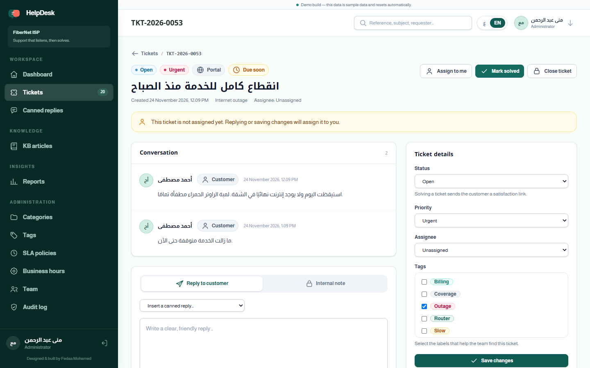
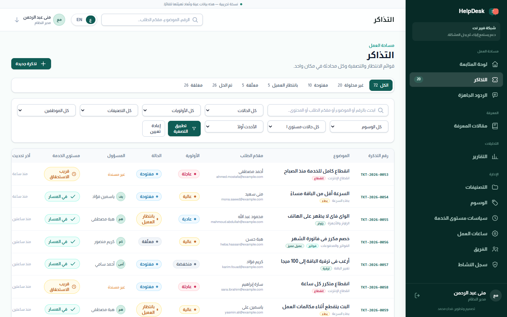
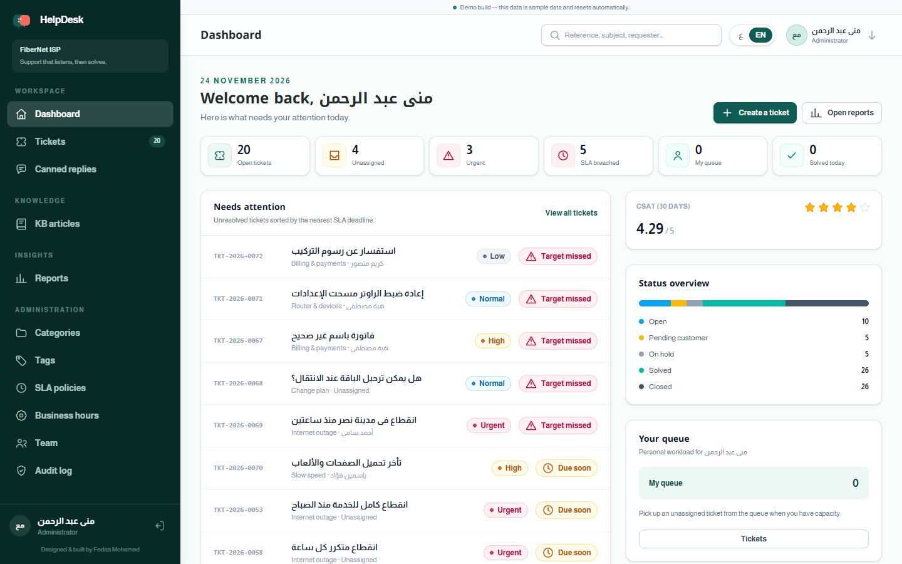
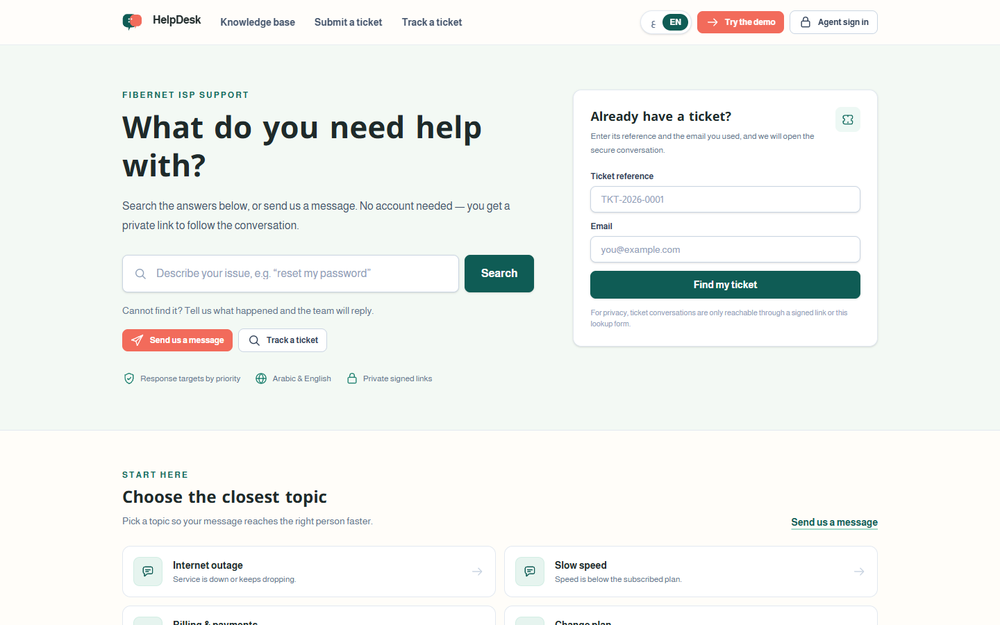
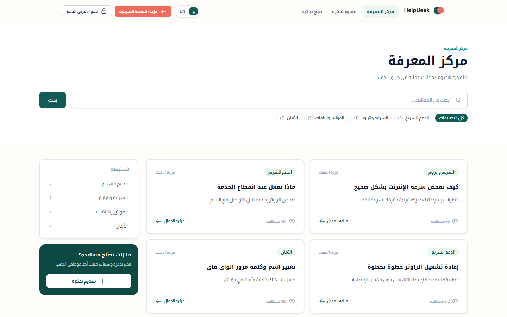
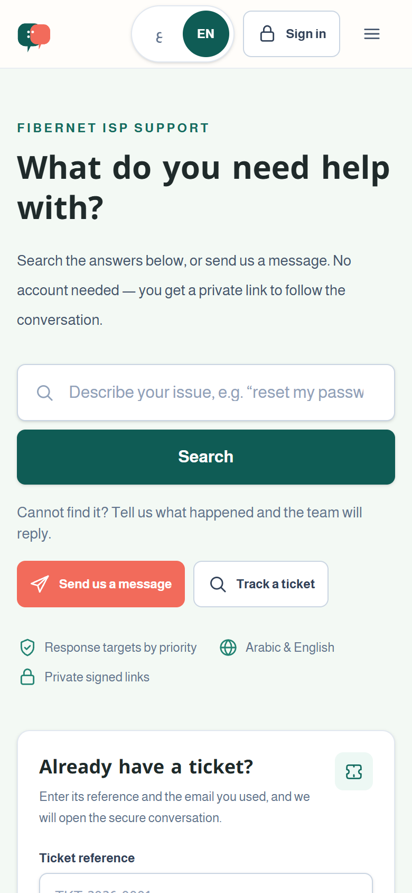
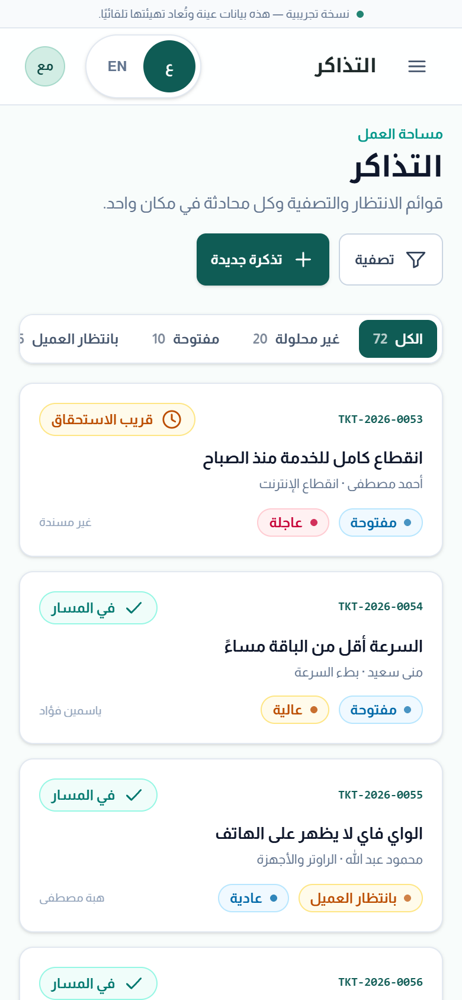
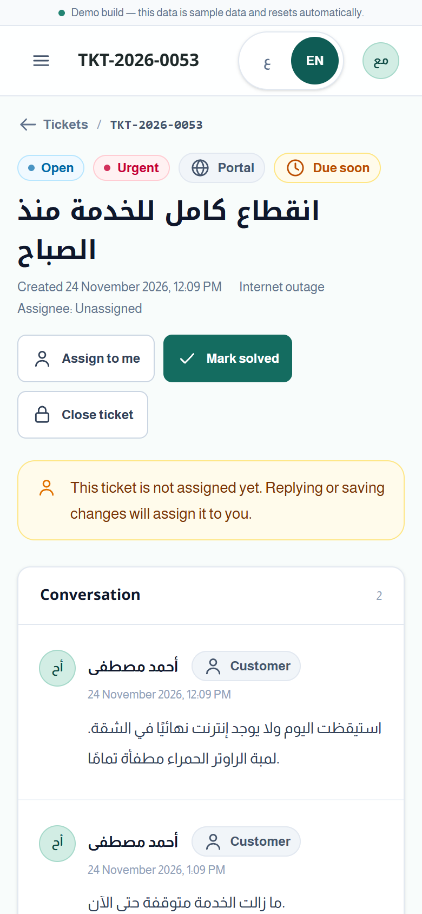

# HelpDesk

Customer support desk: a public help portal, a ticket workspace for agents, SLAs and a knowledge base.



HelpDesk covers the full support workflow. Customers search the knowledge base or open a ticket without an account and follow it through a private signed link. Agents work from a three-pane workspace with chat-style conversations, while supervisors track SLAs and satisfaction.

The demo is the support centre of **FiberNet**, a fictional internet provider, with sample tickets about outages, speed, billing and routers.

The interface is Arabic-first (right-to-left) with a complete English version.

## Highlights

- **Public portal:** knowledge-base search, topic shortcuts, ticket submission with validated attachments and ticket tracking.
- **Agent workspace:** queues, filters, assignment, priorities, statuses, internal notes, canned replies and tags.
- **SLA:** first-response and resolution targets per priority, calculated in business hours, with breach indicators.
- **Customer satisfaction:** a signed rating link after a ticket is solved.
- **Knowledge base** in Arabic and English, with drafts and published articles.
- **Roles:** Admin, Supervisor and Agent, checked on the server for every action.
- **Reports:** volume, response and resolution times, SLA compliance, satisfaction and per-agent performance, with CSV export.
- **Email-in simulation:** an Artisan command turns `.eml` files into tickets or threaded replies.

## Screenshots

**Ticket queue** · Arabic



**Dashboard** · English



**Public help portal** · English



**Knowledge base** · Arabic



**On mobile** (English and Arabic)

<p>
  
  
  
</p>

## Tech stack

| Layer | Technology |
| --- | --- |
| Backend | PHP 8.4, Laravel 13 |
| Frontend | Blade, Tailwind CSS 4, Alpine.js 3 (CSP build), Vite 8 |
| Database | SQLite |
| Fonts | Almarai and Noto Kufi Arabic, self-hosted |
| Tests | PHPUnit feature tests |

No CDNs, trackers or analytics. All fonts and assets are self-hosted.

## Running locally

Requirements: PHP 8.3+ with the `pdo_sqlite`, `sqlite3`, `mbstring`, `fileinfo` and `zip` extensions, Composer 2, Node.js 24 and npm.

```bash
composer install
cp .env.example .env
php artisan key:generate
touch database/database.sqlite
php artisan migrate --seed
php artisan storage:link
npm install
npm run build
php artisan serve
```

Then open http://127.0.0.1:8000 (agent workspace at `/app`).

Full setup notes are in [INSTALL.md](INSTALL.md).

## Demo access

The sign-in page has **Try the demo** buttons for Admin, Supervisor and Agent. One click, no password. Demo data resets every hour (`php artisan demo:reset --force`). Set `DEMO_MODE=false` in `.env` to remove the demo entry points.

All names, phone numbers, emails and records in the demo are fictional sample data.

## Tests

```bash
php artisan test
```

90 automated tests, all passing at the time of publishing. Details in [TESTING.md](TESTING.md).

## Documentation

- [INSTALL.md](INSTALL.md)
- [TESTING.md](TESTING.md)
- [SECURITY.md](SECURITY.md)
- [ROADMAP.md](ROADMAP.md)
- [docs/ARCHITECTURE.md](docs/ARCHITECTURE.md)
- [docs/DECISIONS.md](docs/DECISIONS.md)
- [THIRD-PARTY-NOTICES.md](THIRD-PARTY-NOTICES.md)

## License

Copyright © 2026 Fedaa Mohamed. All rights reserved.

This repository is public so the code can be reviewed. It is **not open source**: no permission is granted to use, copy, modify, distribute or sell any part of it without prior written permission. See [LICENSE](LICENSE). Third-party libraries and fonts keep their own licences, listed in [THIRD-PARTY-NOTICES.md](THIRD-PARTY-NOTICES.md).

---

Designed & built by [Fedaa Mohamed](https://fedaamohamed.com).
